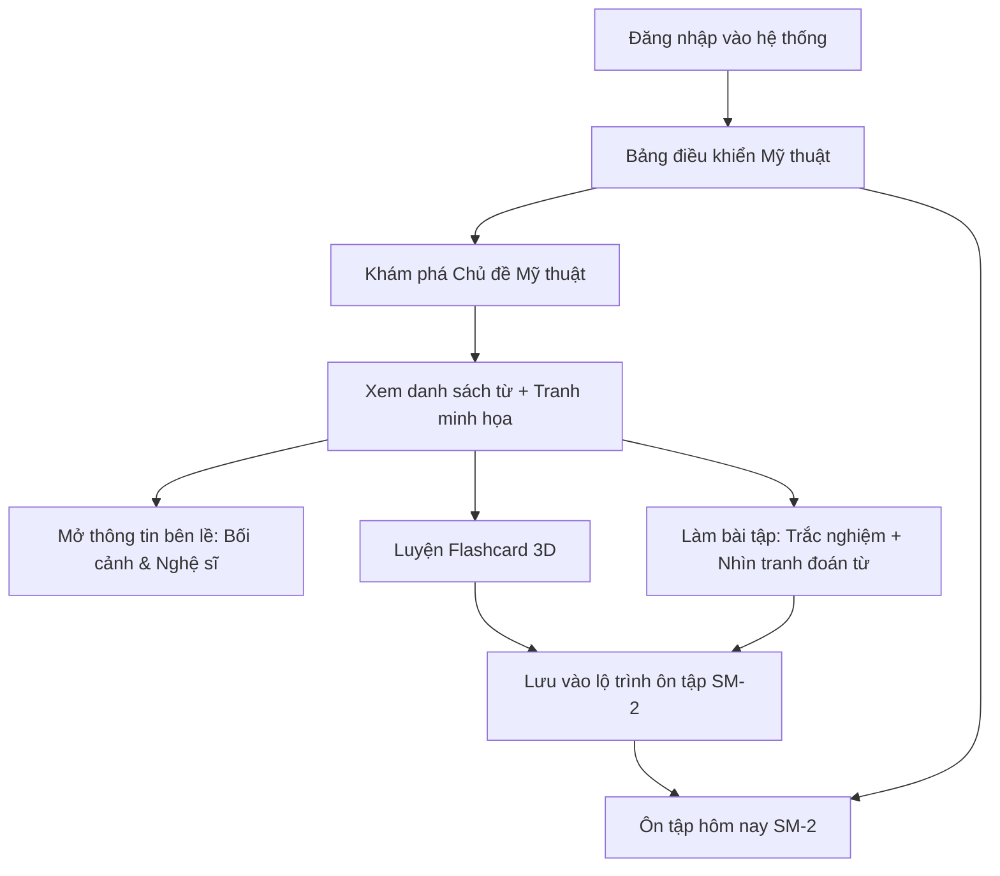

# TÀI LIỆU ĐẶC TẢ CHI TIẾT CHỨC NĂNG HỆ THỐNG ENGLEARN
## CHUYÊN NGÀNH: TỪ VỰNG TIẾNG ANH MỸ THUẬT & MỸ NGHỆ (FINE ARTS & CRAFTS)

> **Dự án:** EngLearn - Nền tảng học Tiếng Anh chuyên sâu về Mỹ thuật & Mỹ nghệ  
> **Phiên bản:** 2.0.0 (Fine Arts Edition)  
> **Đặc trưng cốt lõi:**  
> - Chuyên biệt hóa 100% về thuật ngữ **Hội họa (Types of Paintings)** và **Ngành nghề Mỹ nghệ thủ công (Fine Arts & Crafts Professions)**.  
> - Mỗi thuật ngữ đều có **cơ chế hiển thị hình ảnh minh họa tác phẩm chuẩn xác (`VocabImage`)** kèm cơ chế dự phòng và phóng to.  
> - Cung cấp **thông tin bên lề & bối cảnh văn hóa - lịch sử (`VocabSidebarInfo`)**, nghệ sĩ / làng nghề tiêu biểu và nguồn tham chiếu uy tín (Oxford Art, Tate, Britannica).  
> - Tối ưu hóa trí nhớ dài hạn bằng thuật toán lặp lại ngắt quãng **SuperMemo 2 (SM-2)**.  
> - Tạm thời tinh giản các cơ chế học nhóm, đọc hiểu và cộng đồng để tập trung tối đa vào trải nghiệm học từ vựng trực quan.

---

## 📑 MỤC LỤC TỔNG QUAN

1. [TỔNG QUAN HỆ THỐNG & CÔNG NGHỆ](#1-tổng-quan-hệ-thống--công-nghệ)
2. [MA TRẬN PHÂN QUYỀN HỆ THỐNG](#2-ma-trận-phân-quyền-hệ-thống)
3. [SƠ ĐỒ LUỒNG HỌC THUẬT NGỮ TRỌNG TÂM](#3-sơ-đồ-luồng-học-thuật-ngữ-trọng-tâm)
4. [CHI TIẾT CÁC PHÂN HỆ CHỨC NĂNG](#4-chi-tiết-các-phân-hệ-chức-năng)
   - [Phân hệ 1: Xác thực & Hồ sơ cá nhân](#phân-hệ-1-xác-thực--hồ-sơ-cá-nhân)
   - [Phân hệ 2: Khám phá Thuật ngữ Mỹ thuật & Mỹ nghệ](#phân-hệ-2-khám-phá-thuật-ngữ-mỹ-thuật--mỹ-nghệ)
   - [Phân hệ 3: Cơ chế Hình ảnh Minh họa & Thông tin Bên lề](#phân-hệ-3-cơ-chế-hình-ảnh-minh-họa--thông-tin-bên-lề)
   - [Phân hệ 4: Học Thẻ ghi nhớ Flashcards 3D](#phân-hệ-4-học-thẻ-ghi-nhớ-flashcards-3d)
   - [Phân hệ 5: Luyện tập & Đố vui Nhận diện Tranh (Quiz Generator)](#phân-hệ-5-luyện-tập--đố-vui-nhận-diện-tranh)
   - [Phân hệ 6: Ôn tập Ngắt quãng Thông minh (Spaced Repetition SM-2)](#phân-hệ-6-ôn-tập-ngắt-quãng-thông-minh-sm-2)
   - [Phân hệ 7: Sổ từ vựng Cá nhân (User Custom Vocab Lists)](#phân-hệ-7-sổ-từ-vựng-cá-nhân)
   - [Phân hệ 8: Bảng Quản trị & Thống kê Hệ thống](#phân-hệ-8-bảng-quản-trị--thống-kê-hệ-thống)
5. [CƠ SỞ DỮ LIỆU ĐÃ TINH GIẢN](#5-cơ-sở-dữ-liệu-đã-tinh-giản)

---

## 1. TỔNG QUAN HỆ THỐNG & CÔNG NGHỆ

### 1.1. Công nghệ sử dụng
- **Frontend:** React 19, Tailwind CSS v4, React Router DOM v7, Zustand, Axios, React Hot Toast.
- **Backend:** Node.js, Express.js 5, Sequelize ORM 6.
- **Cơ sở dữ liệu:** MySQL 8.0 (hỗ trợ lưu trữ văn bản Unicode UTF-8 đa ngôn ngữ, bối cảnh văn hóa chi tiết).
- **Bộ hình ảnh:** 60 hình ảnh minh họa tác phẩm mỹ thuật & thủ công (`.jpg`) kèm ảnh dự phòng `_placeholder.svg` lưu trữ cục bộ trong thư mục `client/public/images/vocab/`.

---

## 2. MA TRẬN PHÂN QUYỀN HỆ THỐNG

| Chức năng | Khách vãng lai | Học viên Mỹ thuật | Quản trị viên (Admin) |
|---|:---:|:---:|:---:|
| Đăng ký, Đăng nhập, Xem Dashboard | ❌ / Giới hạn | ✅ | ✅ |
| Khám phá từ vựng theo chủ đề hội họa & mỹ nghệ | ❌ | ✅ | ✅ |
| Xem hình ảnh minh họa + Phóng to ảnh | ❌ | ✅ | ✅ |
| Xem thông tin bên lề, bối cảnh lịch sử & nghệ sĩ | ❌ | ✅ | ✅ |
| Học thẻ ghi nhớ Flashcard 3D | ❌ | ✅ | ✅ |
| Làm bài tập trắc nghiệm & nhìn tranh đoán từ | ❌ | ✅ | ✅ |
| Ôn tập ngắt quãng theo thuật toán SM-2 | ❌ | ✅ | ✅ |
| Tạo và quản lý sổ từ vựng cá nhân | ❌ | ✅ | ✅ |
| Quản lý tài khoản người dùng & số liệu hệ thống | ❌ | ❌ | ✅ |
| Thêm/Sửa/Xóa từ vựng và bối cảnh văn hóa | ❌ | ❌ | ✅ |

---

## 3. SƠ ĐỒ LUỒNG HỌC THUẬT NGỮ TRỌNG TÂM

---

## 4. CHI TIẾT CÁC PHÂN HỆ CHỨC NĂNG

### Phân hệ 1: Xác thực & Hồ sơ cá nhân
- **Đăng ký / Đăng nhập:** Xác thực người dùng qua JWT bảo mật (Access token + Refresh token). Sau khi đăng ký, người dùng được điều hướng trực tiếp vào Bảng điều khiển học tập.
- **Hồ sơ cá nhân:** Cập nhật thông tin, ảnh đại diện, đổi mật khẩu và xem thống kê tiến độ học từ vựng.

### Phân hệ 2: Khám phá Thuật ngữ Mỹ thuật & Mỹ nghệ
- **2 Chuyên đề học tập chính:**
  1. *Types of Paintings (Các loại tranh):* oil painting, watercolor, fresco, portrait, chiaroscuro, surrealism, impressionism, triptych...
  2. *Fine Arts & Crafts Professions (Ngành nghề mỹ nghệ):* ceramics, lacquerware, embroidery, woodcarving, silversmithing, mosaic, glassblowing...
- **Bộ lọc & Tìm kiếm:** Tìm kiếm tức thời theo tên thuật ngữ tiếng Anh, nghĩa tiếng Việt, tên nghệ sĩ hoặc bối cảnh văn hóa. Lọc theo 3 mức độ (Căn bản, Trung cấp, Chuyên sâu).

### Phân hệ 3: Cơ chế Hình ảnh Minh họa & Thông tin Bên lề
- **Component `VocabImage`:**
  - Hiển thị hình ảnh minh họa sắc nét cho từng từ vựng.
  - Tự động hiển thị khung chờ (skeleton loading) khi đang tải ảnh.
  - Tự động bắt lỗi và hiển thị ảnh dự phòng chuẩn nghệ thuật (`/images/vocab/_placeholder.svg`) nếu ảnh thiếu hoặc link lỗi.
  - Hỗ trợ tính năng Click để phóng to (Zoom Preview Modal) cho phép người học chiêm ngưỡng chi tiết tranh.
- **Component `VocabSidebarInfo`:**
  - **Bối cảnh văn hóa & Lịch sử nghệ thuật:** Nguồn gốc ra đời của kỹ thuật, giai đoạn lịch sử phát triển, phong trào nghệ thuật liên quan.
  - **Nghệ sĩ & Làng nghề tiêu biểu:** Tên các danh họa kiệt xuất thế giới (Jan van Eyck, Monet, Picasso, Michelangelo) hoặc các làng nghề truyền thống danh tiếng của Việt Nam (Sơn mài Tương Bình Hiệp, Gốm Bát Tràng, Lụa Vạn Phúc, Bạc Định Công...).
  - **Nguồn từ điển tham chiếu chuẩn:** Ghi rõ tài liệu tham khảo chuyên ngành (Oxford Art Dictionary, Tate Art Glossary, Britannica).

### Phân hệ 4: Học Thẻ ghi nhớ Flashcards 3D
- **Mặt trước:** Hình ảnh minh họa tranh/nghề thủ công, thuật ngữ tiếng Anh, phiên âm IPA, nút nghe phát âm giọng bản xứ chuẩn.
- **Mặt sau:** Nghĩa tiếng Việt, ví dụ câu ngữ cảnh kèm dịch nghĩa, khối thông tin bên lề với bối cảnh văn hóa và nghệ sĩ tiêu biểu.
- **Thao tác lật thẻ:** Bằng chuột hoặc phím tắt `Space`, phím mũi tên `←` / `→` để chuyển từ tiếp theo. Nút "Đã nhớ từ này" tự động đưa từ vào chu kỳ ôn tập ngắt quãng.

### Phân hệ 5: Luyện tập & Đố vui Nhận diện Tranh (Quiz Generator)
- **4 dạng bài tập tạo tự động từ CSDL:**
  1. *Nhìn tranh đoán thuật ngữ (`image_to_word`):* Hiển thị hình ảnh tranh minh họa, yêu cầu học viên nhận biết đúng thể loại hoặc nghề thủ công tương ứng.
  2. *Tiếng Anh sang Tiếng Việt (`en_to_vi`):* Hỏi nghĩa của thuật ngữ mỹ thuật.
  3. *Tiếng Việt sang Tiếng Anh (`vi_to_en`):* Chọn thuật ngữ tiếng Anh chuẩn xác.
  4. *Điền từ vào ngữ cảnh (`fill_blank`):* Điền từ thích hợp vào câu ví dụ chuyên ngành mỹ thuật.
- **Chấm điểm & Củng cố:** Sau khi nộp bài, hệ thống hiển thị đáp án chi tiết và toàn bộ thông tin bên lề văn hóa để học viên củng cố kiến thức.

### Phân hệ 6: Ôn tập Ngắt quãng Thông minh (Spaced Repetition SM-2)
- Tự động tính toán chu kỳ ôn tập dựa trên phản hồi của người học (Chưa nhớ, Khó nhớ, Nhớ tốt, Rất dễ).
- Đưa từ vựng vào hàng đợi ôn tập đúng ngày trước khi não bộ quên lãng.
- Hỗ trợ ôn tập linh hoạt: Ôn từ đến hạn hôm nay hoặc chủ động ôn tập toàn bộ các từ đang học.

### Phân hệ 7: Sổ từ vựng Cá nhân (User Custom Vocab Lists)
- Cho phép người học tự tạo các danh mục từ vựng yêu thích (ví dụ: *Thuật ngữ chuẩn bị thi*, *Hội họa Phục hưng*, *Gốm sứ Á Đông*).
- Thêm từ nhanh từ trang chi tiết chủ đề hoặc trang ôn tập.

### Phân hệ 8: Bảng Quản trị & Thống kê Hệ thống
- **Quản lý người dùng:** Xem danh sách, thay đổi vai trò (học viên, quản trị viên), khóa/mở khóa tài khoản.
- **Thống kê tổng quan:** Giám sát tổng số người học, tổng số thuật ngữ mỹ thuật và chủ đề trên toàn hệ thống.

---

## 5. CƠ SỞ DỮ LIỆU ĐÃ TINH GIẢN

Các bảng dữ liệu trong CSDL MySQL hiện tại:
1. `users`: Tài khoản và thông tin người học.
2. `topics`: 2 chuyên đề mỹ thuật lớn.
3. `vocabularies`: 60 thuật ngữ mỹ thuật & mỹ nghệ, lưu trữ `image_url`, `image_alt`, `cultural_note`, `related_artist`, `source_ref`.
4. `vocab_examples`: Câu ví dụ ngữ cảnh tiếng Anh và bản dịch.
5. `user_vocab_progress`: Dữ liệu thuật toán lặp lại ngắt quãng SM-2 của từng học viên.
6. `review_schedules`: Lịch hẹn ôn tập cá nhân.
7. `user_vocab_lists`: Các sổ từ vựng cá nhân do người học tự tạo.
8. `user_vocab_list_items`: Liên kết từ vựng vào sổ từ cá nhân.

*(Đã xóa bỏ hoàn toàn các bảng: `groups`, `group_members`, `group_vocab_sets`, `group_vocab_items`, `group_reading_sets`, `readings`, `questions`, `user_reading_attempts`, `user_answers`, `community_posts`, `level_assessments`)*.
