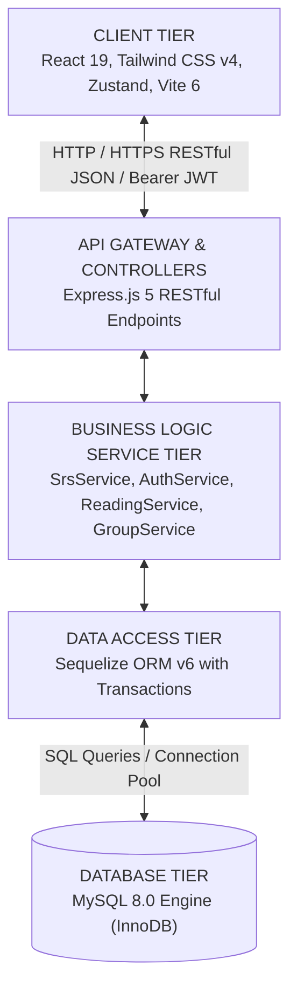

# CHƯƠNG 1: TỔNG QUAN ĐỀ TÀI VÀ CƠ SỞ KỸ THUẬT

---

## 1.1. KHẢO SÁT BÀI TOÁN THỰC TẾ VÀ NHU CẦU NGHIÊN CỨU

### 1.1.1. Bối cảnh chuyển đổi số và nhu cầu ngoại ngữ chuyên ngành Mỹ thuật - Thủ công mỹ nghệ

Trong kỷ nguyên công nghiệp 4.0 và xu thế toàn cầu hóa nền kinh tế sáng tạo (Creative Economy), các ngành nghệ thuật thị giác (Fine Arts), thiết kế công nghiệp, kiến trúc và đặc biệt là thủ công mỹ nghệ truyền thống (Traditional Handicrafts) tại Việt Nam đang đứng trước cơ hội to lớn để tiếp cận thị trường quốc tế. Việc giới thiệu các tác phẩm nghệ thuật, sản phẩm gốm sứ Bát Tràng, sơn mài Hạ Thái, điêu khắc gỗ chạm khảm hay lụa Vạn Phúc tới bạn bè năm châu không chỉ mang lại giá trị kinh tế mà còn là sứ mệnh quảng bá bản sắc văn hóa dân tộc.

Tuy nhiên, rào cản lớn nhất đối với sinh viên mỹ thuật, nghệ nhân và các nhà sáng tạo trẻ hiện nay chính là năng lực ngoại ngữ chuyên ngành. Tiếng Anh chuyên ngành Mỹ thuật và Thủ công mỹ nghệ có hệ thống thuật ngữ mang tính đặc thù cao, đòi hỏi sự am hiểu sâu sắc về:
* **Lý thuyết thị giác và tạo hình:** Các khái niệm về bố cục (*composition*), phối cảnh (*perspective*), quang sai (*chiaroscuro*), sắc độ (*hue, saturation, value*), chất cảm bề mặt (*texture*).
* **Vật liệu và chất liệu nghệ thuật:** Các chất liệu chuyên biệt như sơn dầu (*oil paint*), màu nước (*watercolor*), chất kết dính (*binder, medium*), đất sét nung (*terracotta*), men rạn (*crackle glaze*), khảm trai (*mother-of-pearl inlay*).
* **Kỹ thuật và công nghệ chế tác:** Kỹ thuật đổ khuôn (*slip casting*), gò đồng (*chasing and repoussé*), dệt thủ công (*handloom weaving*), tiện gỗ (*woodturning*).
* **Lịch sử và trào lưu nghệ thuật:** Từ chủ nghĩa cổ điển (*Classicism*), lãng mạn (*Romanticism*), ấn tượng (*Impressionism*) tới hiện đại và đương đại (*Contemporary Art*).

Việc thiếu hụt hệ thống tài liệu chuẩn mực và môi trường học tập ứng dụng công nghệ khiến người học mất rất nhiều thời gian tra cứu, dễ nản chí và khó duy trì thói quen học tập bền vững.

---

### 1.1.2. Phân tích và đánh giá các giải pháp hỗ trợ học tiếng Anh hiện hành

Hiện nay, trên thị trường công nghệ giáo dục (EdTech) có nhiều ứng dụng học tiếng Anh nổi tiếng, song khi đối chiếu với bài toán học tiếng Anh chuyên ngành Mỹ thuật và Thủ công mỹ nghệ, các ứng dụng này đều bộc lộ những ưu và nhược điểm rõ rệt:

#### 1. Duolingo
* **Ưu điểm:** Giao diện trực quan, tính năng Gamification (chuỗi Streak, bảng xếp hạng, huy hiệu) kích thích người dùng duy trì thói quen tốt; giao diện thân thiện với người bắt đầu.
* **Hạn chế lớn:** 
  * Nội dung hoàn toàn là tiếng Anh giao tiếp đại chúng thường nhật (Daily conversation).
  * Câu từ mang tính máy móc, thiếu ngữ cảnh chuyên ngành.
  * Không cho phép người dùng tự tạo kho từ vựng chuyên ngành hoặc tự biên soạn bài đọc theo nhu cầu.

#### 2. Quizlet
* **Ưu điểm:** Khả năng tạo và chia sẻ Flashcard linh hoạt; hỗ trợ nhiều chế độ học (Learn, Test, Match).
* **Hạn chế lớn:**
  * Thuật toán phân bổ ôn tập dựa trên các mốc thời gian cố định hoặc ngẫu nhiên, không tối ưu hóa theo mô hình toán học trí nhớ thực thụ.
  * Bản miễn phí bị giới hạn nhiều tính năng nâng cao, có quảng cáo làm gián đoạn trải nghiệm học tập.
  * Thiếu hoàn toàn tính năng luyện đọc hiểu chuyên sâu song ngữ và công cụ đánh giá năng lực đầu vào tích hợp.

#### 3. Anki
* **Ưu điểm:** Ứng dụng mã nguồn mở kinh điển áp dụng thuật toán lặp lại ngắt quãng SuperMemo SM-2; khả năng tùy biến mạnh mẽ, hỗ trợ nhiều nền tảng.
* **Hạn chế lớn:**
  * Giao diện người dùng (UI/UX) cổ điển, phức tạp, thiếu tính thân thiện; đòi hỏi người học phải có kỹ năng cấu hình kỹ thuật nhất định.
  * Hoàn toàn thiếu các yếu tố tương tác xã hội hiện đại như: phòng học nhóm (Study Groups), chia sẻ tài liệu trực tiếp theo mã mời (Invite Code), diễn đàn đóng góp cộng đồng (UGC).
  * Không tích hợp ngữ cảnh bài đọc đọc hiểu song ngữ đi kèm các bộ từ vựng; việc học hoàn toàn tách rời giữa thẻ từ và văn bản thực tế.

#### Bảng so sánh tổng quan giữa EngLearn và các giải pháp hiện hành

| Tiêu chí so sánh | Duolingo | Quizlet | Anki | EngLearn (Hệ thống đề xuất) |
| :--- | :---: | :---: | :---: | :---: |
| **Độ chuyên biệt chuyên ngành Mỹ thuật** | Rất thấp (Giao tiếp chung) | Thấp (Tùy thuộc người tạo) | Thấp (Tùy thuộc bộ Deck) | **Rất cao (Thiết kế chuyên sâu)** |
| **Thuật toán ôn tập khoa học** | Chu kỳ cố định | Chu kỳ ngắn hạn | SM-2 tiêu chuẩn | **Thuật toán SM-2 chuẩn hóa** |
| **Minh họa trực quan chuyên ngành** | Hoạt họa minh họa chung | Tải ảnh tự do | Tải ảnh tự do | **Bộ vector SVG chuẩn học thuật** |
| **Luyện đọc hiểu song ngữ bối cảnh** | Không có | Không có | Không có | **Có (Đối chiếu từ vựng theo đoạn)** |
| **Học nhóm cộng tác & Giao bài** | Rất hạn chế | Có (Gói trả phí) | Không có | **Hỗ trợ đầy đủ (Mã mời, Phân quyền)** |
| **Đánh giá năng lực đầu vào (Placement Test)**| Có (Trắc nghiệm cơ bản) | Không | Không | **Có (30 câu phân hóa đa cấp độ)** |
| **Giao diện & Trải nghiệm (UI/UX)** | Hiện đại, Gamified | Hiện đại | Cổ điển, khó dùng | **Học thuật, Tinh tế (Scholar UI)** |

---

### 1.1.3. Định hướng giải pháp của hệ thống EngLearn

Khắc phục triệt để các hạn chế của những nền tảng kể trên, hệ thống **EngLearn** được định hướng xây dựng như một hệ sinh thái học tập toàn diện dành riêng cho cộng đồng yêu thích Mỹ thuật và Nghệ thuật truyền thống:
1. **Chuẩn hóa kho ngữ liệu học thuật:** Xây dựng cơ sở dữ liệu chuyên biệt gồm các chủ đề cốt lõi (*Fine Arts Fundamentals*, *Vietnamese Traditional Handicrafts*) với phát âm chuẩn, phiên âm quốc tế IPA, ví dụ thực tế và hình ảnh vector SVG sắc nét biểu thị đúng bản chất thị giác của thuật ngữ.
2. **Cá nhân hóa tiến trình ôn tập bằng thuật toán SM-2:** Ứng dụng mô hình toán học SuperMemo-2 giúp tự động tính toán thời điểm "vàng" cần ôn tập lại của từng từ vựng dựa trên lịch sử nhớ/quên của từng cá nhân, chuyển hóa trí nhớ ngắn hạn thành trí nhớ dài hạn.
3. **Kết hợp gắn kết giữa Từ vựng và Đọc hiểu:** Không học từ vựng đơn lẻ mà đặt từ vựng trong bối cảnh các bài đọc chuyên ngành song ngữ (về trường phái Ấn tượng, kỹ thuật làm gốm Bát Tràng, tranh Đông Hồ...). Sau bài đọc có hệ thống câu hỏi trắc nghiệm đánh giá khả năng đọc hiểu và gợi ý bài đọc tiếp theo theo thuật toán năng lực.
4. **Không gian học nhóm cộng tác mở:** Cho phép giảng viên, nhóm trưởng tạo lập không gian học tập chung, chia sẻ bộ từ vựng do chính nhóm biên soạn, theo dõi tiến độ hoàn thành của các thành viên.
5. **Thiết kế giao diện hiện đại và bảo mật vững chắc:** Áp dụng phong cách giao diện Học giả Viện hàn lâm (*Academic Scholar UI*) trên nền tảng công nghệ web hiện đại React 19 và Express.js, đảm bảo tốc độ phản hồi nhanh, bảo mật token JWT và tương thích đa kích thước màn hình.

---

## 1.2. CƠ SỞ LÝ THUYẾT VỀ TRÍ NHỚ VÀ THUẬT TOÁN SM-2

### 1.2.1. Đường cong quên lãng Ebbinghaus (The Forgetting Curve)

Năm 1885, nhà tâm lý học thực nghiệm người Đức **Hermann Ebbinghaus** đã công bố công trình nghiên cứu mang tính đột phá về cơ chế ghi nhớ và lãng quên của con người. Thông qua các thí nghiệm đo lường khả năng nhớ lại các âm tiết vô nghĩa theo thời gian, ông đã khái quát hóa hiện tượng suy giảm trí nhớ thành **Đường cong quên lãng (Forgetting Curve)**.

Công thức toán học mô tả tỷ lệ thông tin còn lưu giữ lại trong não bộ sau khoảng thời gian $t$:

$$R = e^{-\frac{t}{S}}$$

Trong đó:
* $R$ (*Retention*): Tỷ lệ phần trăm lượng kiến thức còn được lưu giữ trong trí nhớ.
* $t$ (*Time*): Khoảng thời gian đã trôi qua kể từ lần học gần nhất.
* $S$ (*Strength of memory*): Độ bền vững của trí nhớ (phụ thuộc vào mức độ tập trung, phương pháp học và số lần được gợi nhắc lại).

```mermaid
flowchart LR
    subgraph Ebbinghaus["Tiến trình Đường cong Quên lãng và Can thiệp SRS"]
        direction TB
        L0["Lần học đầu tiên (100% Trí nhớ)"] -->|Sau 24 giờ| D1["Quên 70% kiến thức (Chỉ còn ~30%)"]
        D1 -->|Ôn tập lần 1 (SM-2: Ngày 1)| L1["Phục hồi 100% - Độ dốc quên thoải hơn"]
        L1 -->|Sau 6 ngày| D2["Bắt đầu suy giảm"]
        D2 -->|Ôn tập lần 2 (SM-2: Ngày 6)| L2["Phục hồi 100% - Trí nhớ bền vững hơn"]
        L2 -->|Sau I(n) ngày| D3["Ôn tập ngắt quãng tiếp theo"]
        D3 --> M["Chuyển hóa vào Trí nhớ Dài hạn (Long-term Memory)"]
    end
```

Nghiên cứu của Ebbinghaus chỉ ra một thực tế phũ phàng: **hơn 70% kiến thức mới tiếp nhận sẽ bị lãng quên chỉ trong vòng 24 đến 48 giờ** nếu không có bất kỳ hành động gợi nhớ hay củng cố nào. Tuy nhiên, nếu một thông tin được chủ động kích hoạt lại đúng vào thời điểm nó chuẩn bị rơi khỏi ngưỡng nhận biết, tốc độ quên lãng của chu kỳ tiếp theo sẽ chậm hơn đáng kể.

---

### 1.2.2. Hệ thống lặp lại ngắt quãng (Spaced Repetition System - SRS)

Dựa trên phát hiện của Ebbinghaus và các nghiên cứu sau này của nhà giáo dục học Sebastian Leitner (với mô hình Hộp Leitner năm 1972), khái niệm **Hệ thống Lặp lại Ngắt quãng (Spaced Repetition System - SRS)** ra đời. 

SRS là phương pháp học tập tối ưu hóa thời gian bằng cách kéo giãn khoảng cách giữa các lần ôn tập:
* Những thông tin người học thấy khó, thường xuyên quên sẽ được hệ thống xếp lịch ôn tập với tần suất dày đặc hơn (hàng ngày hoặc cách ngày).
* Những thông tin người học đã nắm vững sẽ được giãn cách thời gian ôn tập dài hơn (1 tuần, 3 tuần, vài tháng).

Phương pháp này giúp người học loại bỏ việc lãng phí thời gian ôn lại những kiến thức đã quá thành thạo, đồng thời tập trung năng lượng vào các "vùng trũng kiến thức", giúp tăng hiệu suất ghi nhớ lên từ 2 đến 3 lần so với phương pháp nhồi nhét truyền thống (Cramming).

---

### 1.2.3. Mô hình toán học của thuật toán SuperMemo-2 (SM-2)

Thuật toán **SuperMemo-2 (SM-2)** do nhà khoa học người Ba Lan **Piotr Woźniak** phát triển vào năm 1987, là thuật toán lặp lại ngắt quãng nổi tiếng và được kiểm chứng thực nghiệm rộng rãi nhất trên thế giới. SM-2 tính toán khoảng cách của lần ôn tập tiếp theo dựa trên ba biến số trạng thái cốt lõi của từng mục kiến thức:

1. **Số lần lặp lại thành công liên tiếp ($n$ - Repetition count):** Đếm số lần người học trả lời đúng liên tiếp mà không bị gián đoạn bởi câu trả lời sai.
2. **Hệ số độ dễ ($EF$ - Easiness Factor):** Một số thực đại diện cho độ dễ nhớ của mục kiến thức đối với người học. Giá trị khởi tạo mặc định là $EF_0 = 2.5$, với ngưỡng chặn dưới tối thiểu là $EF_{\min} = 1.3$.
3. **Khoảng cách ôn tập ($I(n)$ - Inter-repetition interval):** Số ngày cần chờ trước khi mục kiến thức xuất hiện trở lại trong danh sách ôn tập.

#### Quy trình tính toán chi tiết của SM-2:

**Bước 1: Người học tự đánh giá chất lượng phản hồi ($q$)**  
Sau khi lật thẻ flashcard và xem đáp án, người học chọn một mức điểm $q \in \{0, 1, 2, 3, 4, 5\}$ phản ánh độ chính xác và mức độ trôi chảy khi gợi nhớ.

##### Bảng 1.1: Thang điểm đánh giá chất lượng phản hồi ($q$) trong thuật toán SM-2
| Điểm $q$ | Tên gọi chuẩn | Mô tả trạng thái nhận thức của người học | Hành vi trong hệ thống |
| :---: | :--- | :--- | :--- |
| **0** | Blackout (Quên hoàn toàn) | Hoàn toàn không nhớ ra từ này, mất dấu ấn trí nhớ | Coi là trả lời sai ($q < 3$) |
| **1** | Incorrect (Nhận ra khi thấy) | Sai, nhưng nhìn đáp án thì nhận ra và có ấn tượng | Coi là trả lời sai ($q < 3$) |
| **2** | Familiar (Manh nha quen) | Sai, nhưng từ và nghĩa có vẻ quen thuộc | Coi là trả lời sai ($q < 3$) |
| **3** | Hard (Đúng nhưng vất vả) | Nhớ đúng đáp án, nhưng mất nhiều thời gian đắn đo | Trả lời đạt ($q \ge 3$) |
| **4** | Good (Đúng sau do dự nhẹ)| Nhớ đúng đáp án sau một chút ngập ngừng ngắn | Trả lời đạt ($q \ge 3$) |
| **5** | Easy (Phản xạ tức thì) | Nhớ hoàn hảo, phát âm và nghĩa bật ra tức khắc | Trả lời đạt ($q \ge 3$) |

**Bước 2: Xác định khoảng cách lặp lại tiếp theo $I(n)$**  
Nếu người học trả lời đạt ($q \ge 3$):
* Với lần lặp đầu tiên ($n = 0$): $I(1) = 1$ ngày.
* Với lần lặp thứ hai ($n = 1$): $I(2) = 6$ ngày.
* Với các lần lặp tiếp theo ($n \ge 2$):
  $$I(n+1) = \text{round}(I(n) \times EF)$$
* Số lần lặp được tăng thêm 1: $n \leftarrow n + 1$.

Nếu người học trả lời sai ($q < 3$):
* Chuỗi lặp thành công bị reset về 0: $n \leftarrow 0$.
* Khoảng cách ôn tập bị rút ngắn về ngay ngày hôm sau: $I = 1$ ngày.

**Bước 3: Cập nhật hệ số độ dễ $EF$ mới ($EF'$)**  
Hệ số độ dễ được cập nhật theo công thức hồi quy:

$$EF' = EF + \left(0.1 - (5 - q) \times (0.08 + (5 - q) \times 0.02)\right)$$

* Nếu $q = 5$: $EF' = EF + 0.1$ (độ dễ tăng lên, khoảng cách các lần sau sẽ giãn nhanh hơn).
* Nếu $q = 4$: $EF' = EF$ (độ dễ giữ nguyên).
* Nếu $q < 4$: $EF'$ bị giảm đi theo hàm bậc hai tùy thuộc vào mức độ người học quên hoặc ngập ngừng.
* Điều kiện biên chặn dưới: Để tránh trường hợp $EF$ giảm quá sâu dẫn đến tần suất ôn lặp vô tận, thuật toán quy định:
  $$\text{Nếu } EF' < 1.3 \implies EF' = 1.3$$

**Bước 4: Xác định trạng thái thành thạo (Mastery Status)**  
Trong kiến trúc EngLearn, từ vựng được tự động chuyển từ trạng thái `learning` (đang học) sang `mastered` (thành thạo) khi thỏa mãn đồng thời:
$$n \ge 4 \quad \text{và} \quad I(n) \ge 15 \text{ ngày}$$

Điều này bảo đảm người học chỉ được công nhận là "thành thạo" một thuật ngữ mỹ thuật khi đã ghi nhớ chính xác thuật ngữ đó qua ít nhất 4 chu kỳ lặp và duy trì được trí nhớ ổn định trên nửa tháng.

---

## 1.3. TỔNG QUAN HỆ SINH THÁI CÔNG NGHỆ XÂY DỰNG HỆ THỐNG

Để hiện thực hóa một hệ thống giáo dục trực tuyến có hiệu năng cao, trải nghiệm mượt mà, có khả năng mở rộng và dễ bảo trì, tác giả đã lựa chọn ngăn xếp công nghệ Full-stack JavaScript hiện đại kết hợp cơ sở dữ liệu quan hệ mạnh mẽ.



---

### 1.3.1. Nền tảng phía máy khách (Frontend Client)

#### 1. React 19 và Vite 6
* **React 19:** Phiên bản mới nhất của thư viện giao diện người dùng do Meta phát triển. React tổ chức giao diện theo mô hình kiến trúc dựa trên thành phần (Component-Based Architecture), ứng dụng cơ chế ảo hóa Document Object Model (Virtual DOM) giúp cập nhật giao diện cực nhanh mà không gây tải lại toàn bộ trang. Việc tận dụng tối đa hệ thống React Hooks (`useState`, `useEffect`, `useMemo`, `useCallback`) giúp mã nguồn trong sáng, dễ tái sử dụng và kiểm thử.
* **Vite 6:** Công cụ dựng mã nguồn thế hệ mới sử dụng bộ phân giải mô-đun bản địa ES Modules (ESM) và công cụ biên dịch siêu tốc Rollup/Esbuild. Vite mang lại tốc độ khởi động môi trường phát triển (Hot Module Replacement - HMR) tính bằng mili-giây, giúp tăng năng suất phát triển và tối ưu hóa kích thước gói tệp sau khi đóng gói.

#### 2. Tailwind CSS v4
* Khung phát triển CSS theo trường phái tiện ích hàng đầu (*Utility-first CSS Framework*). Tailwind CSS v4 tối ưu hóa hiệu năng biên dịch nhờ cơ chế engine hoàn toàn mới viết bằng Rust, loại bỏ các tệp CSS dư thừa thông qua quét cú pháp thời gian thực.
* Tác giả sử dụng Tailwind CSS để xây dựng bảng phong cách giao diện học thuật **Academic Scholar Theme**, kết hợp giữa các gam màu xanh đậm hải quân trang nhã (`#1E3A8A`), xanh ngọc biển tri thức (`#0284C7`), xám than học thuật (`#1F2937`) và nền sáng tối thích ứng, mang lại cảm giác tập trung cao độ và không gây mỏi mắt cho người học.

#### 3. Zustand - Thư viện quản lý trạng thái tập trung
* So với sự cồng kềnh và nhiều mã khung mẫu (*boilerplate code*) của Redux, **Zustand** là giải pháp quản lý trạng thái hiện đại, gọn nhẹ với dung lượng gói chưa đến 2KB.
* Zustand sử dụng mô hình Hook tự nhiên, không cần bọc các thành phần trong `Provider`, hỗ trợ lưu trữ trạng thái phiên đăng nhập (`authStore`), tiến trình học từ vựng (`vocabStore`) và cấu hình giao diện một cách trơn tru, hạn chế tối đa số lần re-render không đáng có.

#### 4. React Router DOM v7
* Đảm bảo trải nghiệm Ứng dụng một trang (SPA) đích thực. Hệ thống hỗ trợ định tuyến theo khai báo, cơ chế phân tầng bảo vệ đường dẫn (*Protected Routes*) tự động kiểm tra quyền đăng nhập trước khi cho phép người dùng truy cập vào trang học Flashcard, Bảng điều khiển cá nhân hay Trang quản trị Admin.

#### 5. Axios Client & Interceptor Pipeline
* Thư viện giao tiếp HTTP dạng Promise-based. Tác giả thiết lập hệ thống **Interceptors** chặn luồng gửi đi để tự động đính kèm mã truy cập `Bearer JWT` vào tiêu đề yêu cầu (`Authorization header`), đồng thời chặn luồng nhận về để bắt lỗi hết hạn phiên làm việc và hiển thị thông báo lỗi thân thiện qua thư viện `React Hot Toast`.

---

### 1.3.2. Nền tảng phía máy chủ (Backend Server)

#### 1. Node.js và Express.js 5
* **Node.js (LTS v18/v20):** Môi trường thực thi JavaScript phía máy chủ xây dựng trên nền động cơ V8 của Google. Node.js hoạt động dựa trên cơ chế hướng sự kiện (Event-driven) và mô hình Vào/Ra bất đồng bộ không chặn (Non-blocking I/O Single-Threaded Event Loop), cho phép máy chủ xử lý hàng nghìn kết nối đồng thời với mức tiêu tốn tài nguyên phần cứng cực kỳ thấp.
* **Express.js 5:** Khung ứng dụng web tối giản, linh hoạt bậc nhất cho Node.js. Cấu trúc backend của hệ thống EngLearn được tổ chức nghiêm ngặt theo mô hình phân tách mối quan tâm (**Separation of Concerns - SoC**):
  * **Routes:** Khai báo điểm cuối URI và ánh xạ phương thức HTTP.
  * **Middlewares:** Xử lý xác thực Token, phân quyền người dùng, kiểm tra hợp lệ dữ liệu đầu vào (Input Validation) và bắt lỗi tập trung (Error Handling).
  * **Controllers:** Tiếp nhận yêu cầu HTTP, điều phối luồng dữ liệu và phản hồi mã trạng thái JSON chuẩn hóa.
  * **Services:** Chứa đựng toàn bộ logic nghiệp vụ thuần túy (thuật toán tính toán SM-2, thuật toán gợi ý bài đọc, nghiệp vụ nhóm).
  * **Models:** Định nghĩa cấu trúc lược đồ dữ liệu và quan hệ giữa các bảng.

#### 2. Sequelize ORM và Cơ sở dữ liệu MySQL 8.0
* **MySQL 8.0:** Hệ quản trị cơ sở dữ liệu quan hệ mã nguồn mở phổ biến hàng đầu thế giới, sở hữu động cơ lưu trữ InnoDB hỗ trợ đầy đủ các tính chất ACID (Atomicity, Consistency, Isolation, Durability), khóa dòng (Row-level locking) và chỉ mục B-Tree hiệu năng cao.
* **Sequelize ORM v6:** Thư viện ánh xạ quan hệ - đối tượng (Object-Relational Mapping) toàn diện cho Node.js. Sequelize giúp trừu tượng hóa các câu lệnh SQL truyền thống thành các phương thức hướng đối tượng, cung cấp khả năng tự động đồng bộ lược đồ dữ liệu (Migration), kiểm tra ràng buộc khóa ngoại (Foreign Keys Integrity) và hỗ trợ quản lý giao dịch cơ sở dữ liệu (**Database Transactions**).
* Đặc biệt, trong dịch vụ cập nhật tiến độ học `SrsService.recordReviewAnswer`, tác giả đã áp dụng kỹ thuật **Sequelize Transaction** để đảm bảo tính toàn vẹn: việc cập nhật thông số SM-2 vào bảng `user_vocab_progress` và lên lịch trình mới vào bảng `review_schedules` phải diễn ra đồng thời; nếu một trong hai thao tác gặp lỗi, toàn bộ tiến trình sẽ tự động rollback, loại bỏ triệt để nguy cơ sai lệch dữ liệu lịch học.

#### 3. Cơ chế xác thực và bảo mật hệ thống
* **JSON Web Token (JWT):** Tiêu chuẩn mở công nghiệp (RFC 7519) cho việc truyền tải thông tin an toàn. Người dùng sau khi đăng nhập thành công sẽ nhận được một chuỗi Token được ký điện tử bằng thuật toán băm HMAC-SHA256 với khóa bí mật (`JWT_SECRET`). Token chứa các thông tin định danh tối thiểu (`userId`, `role`) và thời gian sống (`expiresIn: 7d`). Máy chủ không cần lưu session vào bộ nhớ RAM, giúp hệ thống dễ dàng mở rộng theo chiều ngang (Stateless Architecture).
* **bcryptjs:** Thư viện băm mật khẩu một chiều áp dụng thuật toán băm Blowfish có độ phức tạp thích ứng (Salting & Cost factor = 10). Mật khẩu người dùng được băm ngẫu nhiên trước khi lưu trữ vào cơ sở dữ liệu, đảm bảo kể cả khi cơ sở dữ liệu bị lộ lọt, kẻ tấn công cũng không thể dịch ngược lại mật khẩu gốc.
* **CORS & HTTP Security:** Cấu hình Middleware `cors` giới hạn chặt chẽ tên miền truy cập, kết hợp các tiêu chuẩn dọn dẹp dữ liệu đầu vào chống tấn công SQL Injection và XSS.

---

### 1.3.3. Công cụ phân tích và thiết kế hệ thống - Visual Paradigm

Để bảo đảm tính chặt chẽ, chuyên nghiệp và đúng chuẩn mực công nghệ phần mềm trong toàn bộ giai đoạn phân tích và thiết kế đồ án, tác giả đã ứng dụng phần mềm **Visual Paradigm (VP)**.

Visual Paradigm là bộ công cụ thiết kế kiến trúc phần mềm tiêu chuẩn doanh nghiệp hàng đầu hiện nay, hỗ trợ toàn diện:
* Mô hình hóa hướng đối tượng bằng Ngôn ngữ mô hình hóa thống nhất **UML 2.5** (Use Case Diagram, Class Diagram, Sequence Diagram, Activity Diagram, Package Diagram).
* Thiết kế mô hình dữ liệu quan hệ **ERD (Entity Relationship Diagram)** trực quan với đầy đủ kiểu dữ liệu, khóa chính, khóa ngoại, chỉ mục và chú thích tường minh.
* Khả năng xuất bản tự động các tài liệu kiến trúc, mã nguồn lược đồ SQL đồng bộ trực tiếp với cơ sở dữ liệu thực nghiệm.

---

## 1.4. TỔNG KẾT CHƯƠNG 1

Chương 1 đã hoàn thành việc khảo sát toàn diện bối cảnh thực tiễn, phân tích ưu nhược điểm của các giải pháp công nghệ giáo dục hiện hành và khẳng định tính cấp thiết của đề tài xây dựng hệ thống **EngLearn**.

Đồng thời, chương đã trình bày chi tiết cơ sở khoa học nhận thức về trí nhớ của Hermann Ebbinghaus, cơ chế của hệ thống lặp lại ngắt quãng SRS và công thức toán học hoàn chỉnh của thuật toán **SuperMemo-2 (SM-2)**. Toàn bộ hệ sinh thái công nghệ gồm Frontend (React 19, Tailwind CSS v4, Zustand), Backend (Node.js, Express.js 5, Sequelize ORM), Hệ quản trị CSDL (MySQL 8.0) và công cụ thiết kế chuẩn hóa Visual Paradigm đã được phân tích rõ ràng về lý do lựa chọn và vai trò trong hệ thống.

Đây là cơ sở lý thuyết và kỹ thuật vững chắc để bước sang **Chương 2: Phân tích và Thiết kế hệ thống**, nơi các yêu cầu nghiệp vụ sẽ được chuyển hóa thành các biểu đồ mô hình hóa UML, thiết kế kiến trúc phân tầng, lược đồ cơ sở dữ liệu 16 bảng và danh mục RESTful API chi tiết.
