# CHƯƠNG 2: PHÂN TÍCH VÀ THIẾT KẾ HỆ THỐNG

---

## 2.1. ĐẶC TẢ YÊU CẦU HỆ THỐNG (SYSTEM REQUIREMENTS)

### 2.1.1. Yêu cầu chức năng (Functional Requirements)

Dựa trên kết quả khảo sát nghiệp vụ học tiếng Anh chuyên ngành Mỹ thuật và phương pháp ôn tập ngắt quãng SM-2, hệ thống **EngLearn** được phân rã thành 5 phân hệ chức năng trọng tâm:

1. **Phân hệ 1: Xác thực & Đánh giá năng lực đầu vào (Authentication & Placement Assessment)**
   * Đăng ký, đăng nhập tài khoản người học với cơ chế xác thực an toàn qua JSON Web Token (JWT).
   * Khởi tạo bài kiểm tra năng lực đầu vào (*Placement Test*) gồm 30 câu hỏi trắc nghiệm chuyên ngành Mỹ thuật được phân hóa từ cơ bản đến nâng cao.
   * Tự động chấm điểm, phân loại trình độ (Beginner, Intermediate, Advanced) và lưu vết làm bài đầu vào làm căn cứ gợi ý lộ trình học tập.

2. **Phân hệ 2: Học & Ôn tập từ vựng cá nhân hóa theo thuật toán SM-2 (Vocabulary & SRS Review)**
   * Khám phá kho từ vựng chuyên ngành được tổ chức theo chủ đề (*Fine Arts Fundamentals*, *Vietnamese Traditional Handicrafts*) kèm phiên âm quốc tế IPA, từ loại, định nghĩa song ngữ, ví dụ câu ngữ cảnh và hình ảnh vector SVG độc bản.
   * Học từ vựng tương tác qua Thẻ ghi nhớ (*Flashcard*) hai mặt, có tích hợp phát âm chuẩn bản ngữ qua Web Speech API.
   * Luyện tập củng cố từ vựng thông qua bài trắc nghiệm 4 đáp án tự động sinh ngẫu nhiên.
   * Ôn tập ngắt quãng thông minh (*Spaced Repetition System*): Cung cấp giao diện đánh giá phản hồi chất lượng ghi nhớ (thang điểm 0 - 5 theo SM-2); hệ thống tự động tính toán lại Hệ số dễ ($EF$), số lần lặp ($n$), khoảng cách ngày ($I$) và lên lịch hẹn cho chu kỳ tiếp theo.
   * Quản lý sổ tay từ vựng cá nhân (*User Vocab Lists*): Cho phép người học tự tạo bộ sưu tập từ vựng yêu thích.

3. **Phân hệ 3: Luyện kỹ năng Đọc hiểu chuyên ngành & Đề xuất thích ứng (Reading Comprehension)**
   * Cung cấp các bài đọc chuyên đề lịch sử mỹ thuật và làng nghề truyền thống đối chiếu song ngữ Anh - Việt theo từng đoạn văn.
   * Bài tập trắc nghiệm đọc hiểu kèm theo mỗi bài đọc, tự động chấm điểm, tính thời gian làm bài và cung cấp giải thích chi tiết đáp án.
   * Động cơ gợi ý bài đọc (*Recommendation Engine*): Tự động phân tích điểm số đọc hiểu và trình độ của học viên để đề xuất các bài đọc tiếp theo có độ khó phù hợp.

4. **Phân hệ 4: Không gian Học tập Nhóm cộng tác (Collaborative Study Groups)**
   * Tạo nhóm học tập mới và tự động sinh mã mời (*Invite Code*) duy nhất (6 ký tự ngẫu nhiên).
   * Học viên tham gia nhóm nhanh chóng thông qua việc nhập mã mời.
   * Trưởng nhóm (*Group Owner*) có toàn quyền: biên soạn bộ từ vựng nhóm (*Group Vocab Set*), gán bài đọc chuyên đề cho nhóm (*Group Reading Set*), theo dõi danh sách và tiến độ học của từng thành viên.
   * Thành viên nhóm có thể chủ động nhập bộ từ vựng của nhóm vào lịch trình ôn tập cá nhân SM-2 của riêng mình.

5. **Phân hệ 5: Thống kê Gamification & Quản trị hệ thống (Analytics, Streak & CMS)**
   * Theo dõi chuỗi ngày học liên tục (*Streak*), tỷ lệ ghi nhớ chính xác, số lượng từ đã thành thạo (*Mastered*) và từ đang học (*Learning*).
   * Bảng điều khiển Quản trị viên (*Admin Control Panel*): Quản lý toàn diện tài khoản người dùng (khóa/mở tài khoản, phân quyền), kiểm duyệt và quản lý danh mục chủ đề, từ vựng, bài đọc và duyệt bài viết cộng đồng (UGC).

---

### 2.1.2. Yêu cầu phi chức năng (Non-Functional Requirements)

* **Hiệu năng và Thời gian đáp ứng (Performance & Latency):** Thời gian phản hồi của các yêu cầu API cơ bản (tra cứu từ vựng, nộp bài trắc nghiệm) phải đạt dưới 200ms trong điều kiện mạng thông thường. Tốc độ tải trang đầu tiên của ứng dụng Single Page Application đạt dưới 1.5 giây.
* **Tính toàn vẹn và Nhất quán dữ liệu (Data Integrity):** Dữ liệu tính toán lịch ôn tập SRS và giao dịch nhóm phải đảm bảo tính nguyên tử (Atomicity) thông qua cơ chế Database Transactions; không xảy ra hiện tượng mất mát dữ liệu hoặc bất đồng bộ lịch học.
* **Bảo mật và An toàn thông tin (Security):** Mật khẩu người dùng được băm một chiều bằng `bcryptjs` với salt rounds = 10; mã truy cập JWT được ký bằng khóa bí mật phía máy chủ và có thời hạn sống xác định; áp dụng cơ chế CORS giới hạn truy cập trái phép.
* **Khả năng tương thích và Đáp ứng (Compatibility & Responsiveness):** Giao diện tương thích hoàn hảo trên các trình duyệt hiện đại (Chrome, Edge, Firefox, Safari) và tự động thích ứng trên các kích thước màn hình phổ biến từ máy tính để bàn (Desktop), máy tính bảng (Tablet) đến điện thoại thông minh (Mobile).
* **Khả năng bảo trì và Mở rộng (Maintainability & Scalability):** Kiến trúc mã nguồn được phân tách module rõ ràng, tuân thủ nguyên lý Clean Architecture và tách biệt Frontend - Backend, sẵn sàng mở rộng các thuật toán AI/NLP nâng cao trong tương lai.

---

### 2.1.3. Ma trận phân quyền các tác tử (Actor Matrix)

Hệ thống định nghĩa rõ ràng 4 nhóm tác tử tham gia vào quy trình nghiệp vụ:
1. **Khách vãng lai (Guest):** Người dùng chưa đăng nhập, chỉ có quyền xem trang giới thiệu, đăng ký và đăng nhập.
2. **Học viên (Learner / User):** Người dùng thông thường đã xác thực, tham gia học từ vựng, làm bài đọc, ôn tập SM-2 và tham gia nhóm qua mã mời.
3. **Trưởng nhóm học tập (Group Owner):** Học viên sở hữu nhóm học do mình tạo ra, có thêm quyền quản lý thành viên, tạo bộ từ vựng và gán bài đọc nhóm.
4. **Quản trị viên (Admin):** Người điều hành cao nhất, nắm toàn quyền trên hệ thống CMS quản trị.

##### Bảng 2.1: Ma trận phân quyền các tác tử (Actor Matrix) trong hệ thống EngLearn

| Phân hệ chức năng | Mã chức năng | Hành động nghiệp vụ | Khách (Guest) | Học viên (Learner) | Trưởng nhóm (Group Owner) | Quản trị viên (Admin) |
| :--- | :--- | :--- | :---: | :---: | :---: | :---: |
| **Xác thực & Năng lực** | UC-01 | Đăng ký tài khoản mới | ✅ | ❌ | ❌ | ❌ |
| | UC-02 | Đăng nhập hệ thống (nhận JWT) | ✅ | ✅ | ✅ | ✅ |
| | UC-03 | Làm bài đánh giá đầu vào (Placement Test) | ❌ | ✅ | ✅ | ✅ |
| **Từ vựng & SM-2** | UC-04 | Xem danh mục chủ đề & tra cứu từ vựng | ❌ | ✅ | ✅ | ✅ |
| | UC-05 | Học Flashcard & nghe phát âm | ❌ | ✅ | ✅ | ✅ |
| | UC-06 | Đánh giá mức độ nhớ ôn tập theo SM-2 | ❌ | ✅ | ✅ | ✅ |
| | UC-07 | Tạo & quản lý danh sách từ cá nhân | ❌ | ✅ | ✅ | ✅ |
| **Đọc hiểu chuyên ngành** | UC-08 | Đọc bài chuyên đề song ngữ | ❌ | ✅ | ✅ | ✅ |
| | UC-09 | Làm bài kiểm tra đọc hiểu & xem giải thích| ❌ | ✅ | ✅ | ✅ |
| | UC-10 | Nhận đề xuất bài đọc thông minh | ❌ | ✅ | ✅ | ✅ |
| **Không gian nhóm** | UC-11 | Tạo nhóm học tập mới & sinh mã mời | ❌ | ✅ | ✅ | ✅ |
| | UC-12 | Tham gia nhóm qua mã mời (Invite Code) | ❌ | ✅ | ✅ | ✅ |
| | UC-13 | Soạn bộ từ vựng nhóm & gán bài đọc | ❌ | ❌ | ✅ | ✅ |
| | UC-14 | Quản lý & xem tiến độ thành viên nhóm | ❌ | ❌ | ✅ | ✅ |
| **Quản trị & CMS** | UC-15 | Xem thống kê cá nhân & chuỗi Streak | ❌ | ✅ | ✅ | ✅ |
| | UC-16 | Quản lý người dùng (Khóa/Mở/Phân quyền) | ❌ | ❌ | ❌ | ✅ |
| | UC-17 | Quản trị danh mục Từ vựng, Bài đọc | ❌ | ❌ | ❌ | ✅ |
| | UC-18 | Duyệt bài đóng góp cộng đồng (UGC) | ❌ | ❌ | ❌ | ✅ |

---

## 2.2. MÔ HÌNH HÓA USE CASE HỆ THỐNG

### 2.2.1. Sơ đồ Use Case tổng quát toàn hệ thống

##### Hình 2.1: Sơ đồ Use Case tổng quát toàn hệ thống EngLearn trên Visual Paradigm

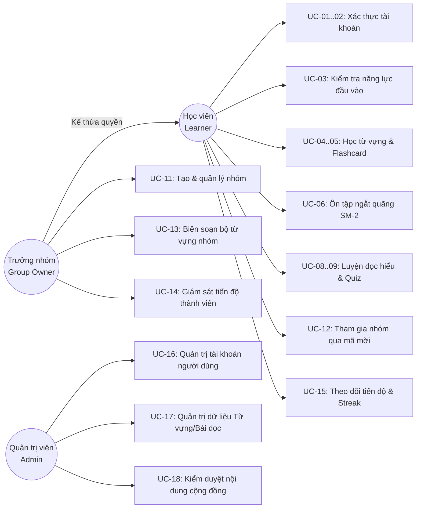

---

### 2.2.2. Sơ đồ Use Case phân rã theo từng phân hệ chức năng

#### Phân hệ 1: Xác thực & Đánh giá năng lực đầu vào

##### Hình 2.2: Sơ đồ Use Case phân rã Phân hệ 1: Xác thực & Đánh giá năng lực đầu vào

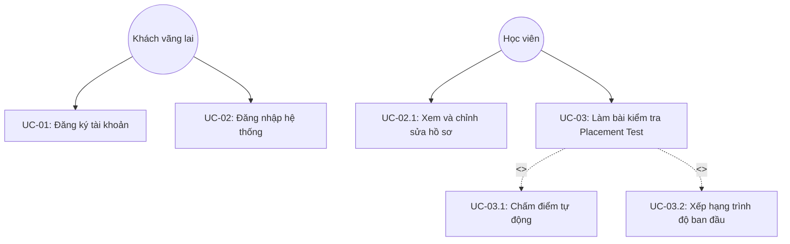

#### Phân hệ 2: Học & Ôn tập từ vựng SM-2

##### Hình 2.3: Sơ đồ Use Case phân rã Phân hệ 2: Học & Ôn tập từ vựng SM-2

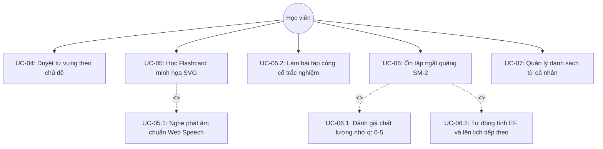

#### Phân hệ 3: Luyện kỹ năng Đọc hiểu chuyên ngành

##### Hình 2.4: Sơ đồ Use Case phân rã Phân hệ 3: Luyện kỹ năng Đọc hiểu chuyên ngành

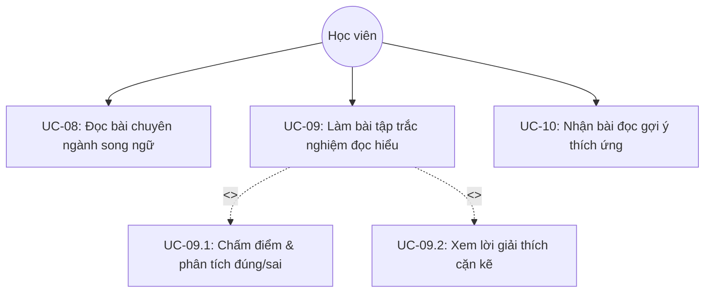

#### Phân hệ 4: Không gian Học tập Nhóm cộng tác

##### Hình 2.5: Sơ đồ Use Case phân rã Phân hệ 4: Không gian Học tập Nhóm cộng tác

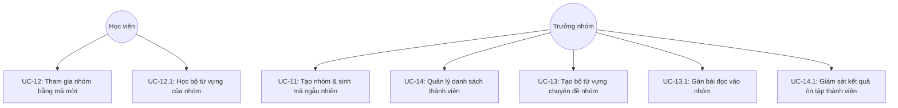

#### Phân hệ 5: Thống kê Gamification & Quản trị hệ thống

##### Hình 2.6: Sơ đồ Use Case phân rã Phân hệ 5: Thống kê Gamification & Quản trị hệ thống

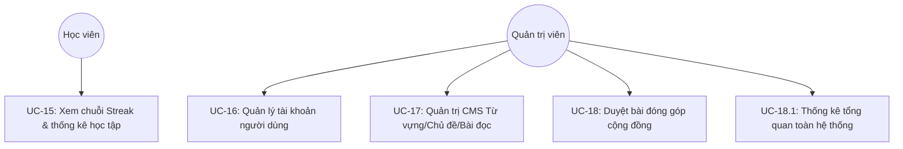

---

### 2.2.3. Bảng đặc tả các Use Case cốt lõi

##### Bảng 2.2: Bảng đặc tả Use Case "Làm bài đánh giá năng lực đầu vào (Placement Test)"

| Mục | Nội dung chi tiết |
| :--- | :--- |
| **Mã Use Case** | **UC-03** |
| **Tên Use Case** | Làm bài kiểm tra đánh giá năng lực đầu vào (Placement Assessment Test) |
| **Tác tử (Actor)**| Học viên (Learner) |
| **Mô tả tóm tắt** | Cho phép học viên mới thực hiện bài kiểm tra trắc nghiệm tiếng Anh mỹ thuật gồm 30 câu để hệ thống xác định trình độ và cá nhân hóa lộ trình học |
| **Tiền điều kiện** | Học viên đã đăng ký và đăng nhập thành công vào hệ thống |
| **Hậu điều kiện** | Kết quả bài thi (điểm số, trình độ ban đầu, chi tiết câu trả lời) được ghi vào bảng `level_assessments`; trường `initial_level` trong hồ sơ học viên được cập nhật |
| **Luồng sự kiện chính (Main Flow)** | 1. Học viên truy cập vào chức năng "Đánh giá trình độ đầu vào". 2. Hệ thống tải ngẫu nhiên bộ câu hỏi từ ngân hàng đề thi chuẩn hóa (30 câu) chia theo 3 mức độ (Dễ, Trung bình, Khó). 3. Học viên đọc câu hỏi và chọn đáp án tương ứng cho từng câu trắc nghiệm. 4. Học viên bấm "Nộp bài kiểm tra". 5. Hệ thống xác nhận và tính tổng điểm dựa trên số câu trả lời chính xác. 6. Hệ thống phân loại trình độ theo ngưỡng: &emsp;- Từ 0 đến 14 câu đúng: **Beginner (Cơ bản)** &emsp;- Từ 15 đến 23 câu đúng: **Intermediate (Trung cấp)** &emsp;- Từ 24 đến 30 câu đúng: **Advanced (Nâng cao)** 7. Hệ thống cập nhật kết quả vào cơ sở dữ liệu và hiển thị bảng phân tích kết quả trực quan cho học viên. |
| **Luồng phụ (Alternative Flow)** | - Tại bước 4, nếu còn câu chưa làm, hệ thống cảnh báo nhưng vẫn cho phép nộp bài nếu học viên đồng ý. - Nếu học viên làm lại bài sau một thời gian, hệ thống ghi nhận bản ghi lịch sử mới để so sánh tiến bộ. |
| **Ngoại lệ (Exception)** | - Mất kết nối mạng khi nộp bài: Hệ thống lưu trạng thái tạm thời trên `localStorage` và gửi lại khi có mạng trở lại. |

---

##### Bảng 2.3: Bảng đặc tả Use Case "Ôn tập từ vựng thông minh (SM-2)"

| Mục | Nội dung chi tiết |
| :--- | :--- |
| **Mã Use Case** | **UC-06** |
| **Tên Use Case** | Ôn tập từ vựng thông minh theo thuật toán lặp lại ngắt quãng SM-2 |
| **Tác tử (Actor)**| Học viên (Learner) |
| **Mô tả tóm tắt** | Học viên thực hiện ôn lại các từ vựng đã đến hạn trong ngày; hệ thống thu thập điểm đánh giá nhớ và tính toán lại tham số SM-2 cho chu kỳ tiếp theo |
| **Tiền điều kiện** | Học viên đã đăng nhập và có ít nhất 1 từ vựng đến hạn ôn tập (`next_review_at <= NOW()`) hoặc chủ động chọn ôn từ đang học |
| **Hậu điều kiện** | Cập nhật $EF$, $interval$, $repetition$, trạng thái từ trong `user_vocab_progress` và lên lịch mới trong `review_schedules` |
| **Luồng sự kiện chính (Main Flow)** | 1. Học viên truy cập màn hình "Ôn tập hôm nay". 2. Hệ thống gọi API truy xuất danh sách từ cần ôn tập đến hạn của học viên. 3. Hệ thống hiển thị mặt trước của thẻ Flashcard (Từ tiếng Anh, phiên âm, nút nghe âm thanh). 4. Học viên tự gợi nhớ và nhấn nút "Lật thẻ" để xem đáp án (Nghĩa tiếng Việt, ví dụ câu, hình vẽ minh họa SVG). 5. Hệ thống xuất hiện bảng thang điểm 6 mức độ (0: Quên hẳn, 1: Nhìn mới nhớ, 2: Manh nha nhớ, 3: Nhớ nhưng vất vả, 4: Nhớ tốt, 5: Nhớ hoàn hảo tức thì). 6. Học viên chọn mức điểm $q$ tương ứng với mức độ nhận thức của mình. 7. Backend thực thi thuật toán `SrsService.calculateSM2`: &emsp;- Nếu $q \ge 3$: Tăng $repetition$, tính khoảng cách ngày mới $I = \text{round}(I \times EF)$. &emsp;- Nếu $q < 3$: Reset $repetition = 0$, gán $I = 1$ ngày. &emsp;- Tính $EF' = EF + (0.1 - (5 - q) \times (0.08 + (5 - q) \times 0.02))$, chặn dưới $EF \ge 1.3$. 8. Hệ thống lưu kết quả trong giao dịch an toàn (Sequelize Transaction) và chuyển sang từ vựng tiếp theo trong hàng đợi. 9. Kết thúc danh sách, hệ thống hiển thị màn hình chúc mừng và cập nhật tiến độ vào thanh thống kê. |
| **Luồng phụ (Alternative Flow)** | - Người học không có từ nào đến hạn: Hệ thống gợi ý chuyển sang chế độ "Ôn tập theo nhu cầu" đối với các từ đang học (`status: learning`). |
| **Ngoại lệ (Exception)** | - Xảy ra lỗi đường truyền cơ sở dữ liệu khi ghi điểm: Giao dịch Transaction tự động rollback, hoàn tác dữ liệu và báo lỗi cho người dùng thử lại. |

---

##### Bảng 2.4: Bảng đặc tả Use Case "Làm bài tập trắc nghiệm Đọc hiểu chuyên ngành"

| Mục | Nội dung chi tiết |
| :--- | :--- |
| **Mã Use Case** | **UC-09** |
| **Tên Use Case** | Làm bài kiểm tra trắc nghiệm Đọc hiểu chuyên ngành Mỹ thuật |
| **Tác tử (Actor)**| Học viên (Learner) |
| **Mô tả tóm tắt** | Học viên đọc bài chuyên luận song ngữ và làm bộ câu hỏi trắc nghiệm ngữ cảnh để rèn luyện tư duy đọc hiểu và củng cố ngữ liệu chuyên ngành |
| **Tiền điều kiện** | Học viên đã đăng nhập và lựa chọn một bài đọc trong danh mục |
| **Hậu điều kiện** | Ghi nhận lượt làm bài vào `user_reading_attempts`, lưu chi tiết lựa chọn vào `user_answers`, kích hoạt thuật toán gợi ý bài đọc tiếp theo |
| **Luồng sự kiện chính (Main Flow)** | 1. Học viên mở bài đọc chuyên đề (ví dụ: *Impressionism Art Movement*). 2. Học viên đọc nội dung bài viết bằng chế độ xem đối chiếu song ngữ Anh - Việt. 3. Học viên nhấn "Bắt đầu làm bài tập trắc nghiệm". 4. Đồng hồ đếm thời gian bắt đầu chạy; hệ thống hiển thị các câu hỏi trắc nghiệm gắn liền với ngữ cảnh đoạn văn. 5. Học viên chọn phương án A, B, C hoặc D cho từng câu hỏi. 6. Học viên bấm nút "Nộp bài". 7. Hệ thống đối chiếu lựa chọn với trường `correct_option` trong bảng `questions`: &emsp;- Tính tổng số câu đúng và điểm số đạt được (thang điểm 100). &emsp;- Tính thời gian hoàn thành (giây). 8. Hệ thống lưu kết quả vào CSDL và trả về giao diện tổng kết bài thi kèm giải thích chi tiết đáp án (`explanation_vi`) cho từng câu. 9. Hệ thống dựa trên điểm số để đưa ra danh sách đề xuất các bài đọc tiếp theo phù hợp. |
| **Luồng phụ (Alternative Flow)** | - Học viên có thể làm lại bài đọc nhiều lần; hệ thống ghi nhận điểm số của lần làm mới nhất vào thống kê đề xuất. |
| **Ngoại lệ (Exception)** | - Bài đọc chưa có câu hỏi kiểm tra: Hệ thống hiển thị thông báo "Bài đọc hiện chỉ hỗ trợ chế độ tự nghiên cứu văn bản". |

---

## 2.3. THIẾT KẾ ĐỘNG HỆ THỐNG (DYNAMIC MODELING)

### 2.3.1. Sơ đồ tuần tự (Sequence Diagrams)

#### Sơ đồ tuần tự: Xác thực người dùng qua JWT

##### Hình 2.7: Sơ đồ tuần tự (Sequence Diagram): Luồng xác thực người dùng JWT

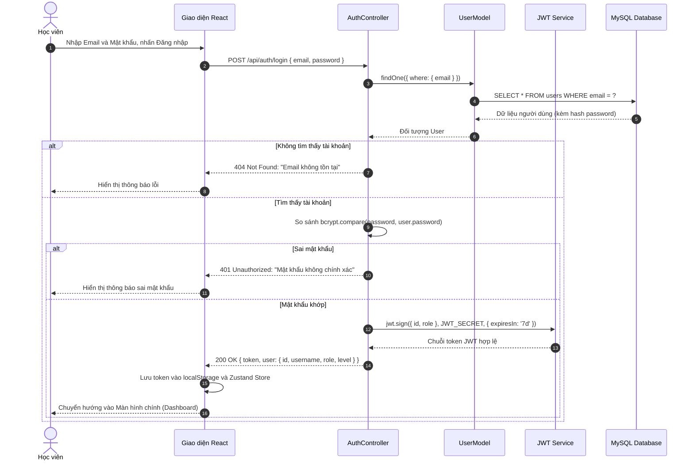

---

#### Sơ đồ tuần tự: Tính toán và cập nhật thuật toán SM-2

##### Hình 2.8: Sơ đồ tuần tự (Sequence Diagram): Luồng tính toán và cập nhật thuật toán SM-2

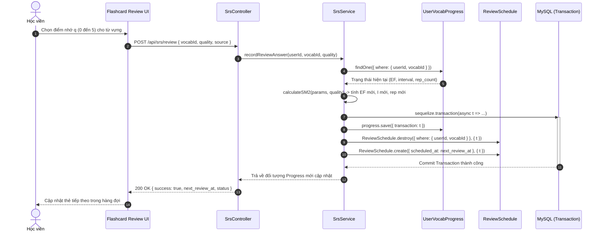

---

#### Sơ đồ tuần tự: Nộp bài và chấm điểm Đọc hiểu

##### Hình 2.9: Sơ đồ tuần tự (Sequence Diagram): Luồng nộp bài và chấm điểm Đọc hiểu

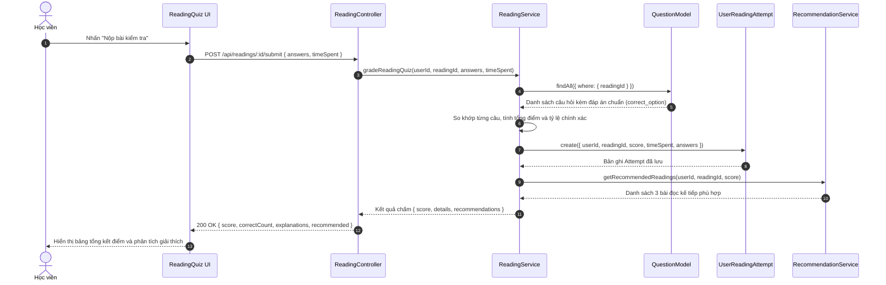

---

### 2.3.2. Sơ đồ hoạt động (Activity Diagrams)

#### Sơ đồ hoạt động: Tiến trình ôn tập Flashcard SM-2

##### Hình 2.10: Sơ đồ hoạt động (Activity Diagram): Tiến trình ôn tập Flashcard SM-2

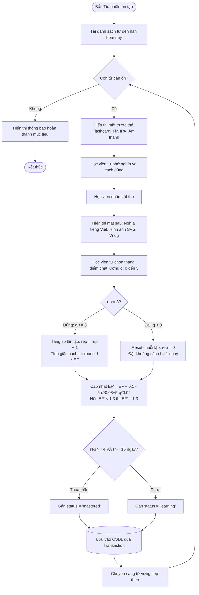

---

#### Sơ đồ hoạt động: Tiến trình làm bài Placement Test

##### Hình 2.11: Sơ đồ hoạt động (Activity Diagram): Tiến trình làm bài Placement Test

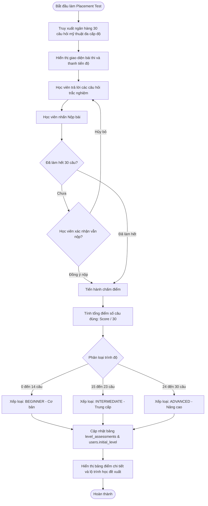

---

## 2.4. THIẾT KẾ CƠ SỞ DỮ LIỆU (DATABASE DESIGN)

### 2.4.1. Danh mục các thực thể trong cơ sở dữ liệu

Hệ thống cơ sở dữ liệu quan hệ của EngLearn bao gồm **16 bảng** được chuẩn hóa ở dạng chuẩn 3 (3NF), đảm bảo không dư thừa dữ liệu và toàn vẹn tham chiếu.

##### Bảng 2.5: Danh mục chi tiết các thực thể trong cơ sở dữ liệu EngLearn (16 bảng)

| STT | Tên bảng | Ý nghĩa nghiệp vụ | Số trường | Khóa ngoại chính |
| :---: | :--- | :--- | :---: | :--- |
| 1 | `users` | Lưu trữ thông tin tài khoản, phân quyền, chuỗi streak, trình độ | 14 | Không có |
| 2 | `level_assessments` | Lưu trữ kết quả các lần làm bài kiểm tra đầu vào (Placement Test) | 9 | `user_id` $\to$ `users.id` |
| 3 | `topics` | Danh mục các chủ đề từ vựng chuyên ngành mỹ thuật | 7 | Không có |
| 4 | `vocabularies` | Từ vựng chuyên ngành (từ, phiên âm, từ loại, nghĩa, độ khó) | 9 | `topic_id` $\to$ `topics.id`, `created_by` $\to$ `users.id` |
| 5 | `vocab_examples` | Các câu ví dụ song ngữ ngữ cảnh đi kèm từ vựng | 6 | `vocabulary_id` $\to$ `vocabularies.id` |
| 6 | `user_vocab_lists` | Danh sách/sổ tay từ vựng do người dùng tự tạo | 7 | `user_id` $\to$ `users.id` |
| 7 | `user_vocab_list_items`| Bảng liên kết trung gian giữa sổ tay từ và từ vựng | 5 | `list_id` $\to$ `user_vocab_lists.id`, `vocabulary_id` $\to$ `vocabularies.id` |
| 8 | `user_vocab_progress` | Tiến độ học tập & tham số thuật toán SM-2 (EF, interval, rep) | 12 | `user_id` $\to$ `users.id`, `vocabulary_id` $\to$ `vocabularies.id` |
| 9 | `review_schedules` | Lịch trình các từ cần ôn tập theo từng mốc thời gian | 8 | `user_id` $\to$ `users.id`, `vocabulary_id` $\to$ `vocabularies.id` |
| 10 | `readings` | Các bài đọc chuyên khảo song ngữ Anh - Việt | 10 | `topic_id` $\to$ `topics.id`, `created_by` $\to$ `users.id` |
| 11 | `questions` | Ngân hàng câu hỏi trắc nghiệm ngữ cảnh đi kèm bài đọc | 8 | `reading_id` $\to$ `readings.id` |
| 12 | `user_reading_attempts`| Lịch sử các lần làm bài kiểm tra đọc hiểu của người dùng | 8 | `user_id` $\to$ `users.id`, `reading_id` $\to$ `readings.id` |
| 13 | `user_answers` | Chi tiết từng câu trả lời trong mỗi lượt làm bài đọc | 7 | `attempt_id` $\to$ `user_reading_attempts.id`, `question_id` $\to$ `questions.id` |
| 14 | `groups` | Không gian nhóm học tập cộng tác và mã mời | 8 | `owner_id` $\to$ `users.id` |
| 15 | `group_members` | Danh sách thành viên và vai trò trong nhóm học | 7 | `group_id` $\to$ `groups.id`, `user_id` $\to$ `users.id` |
| 16 | `group_vocab_sets` | Các bộ từ vựng chuyên đề do nhóm học tập biên soạn | 8 | `group_id` $\to$ `groups.id`, `created_by` $\to$ `users.id` |

---

### 2.4.2. Sơ đồ thực thể liên kết (ERD)

##### Hình 2.12: Sơ đồ Thực thể Liên kết (ERD) hoàn chỉnh 16 bảng dữ liệu trên Visual Paradigm

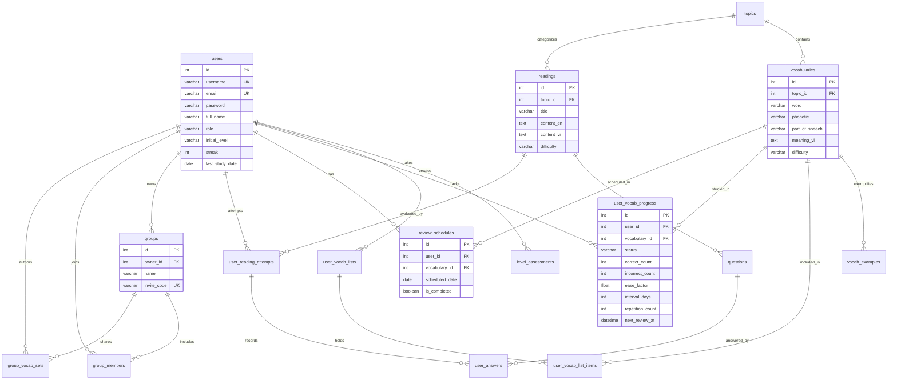

---

## 2.5. THIẾT KẾ KIẾN TRÚC VÀ GIAO DIỆN LẬP TRÌNH ỨNG DỤNG (RESTFUL API)

### 2.5.1. Sơ đồ kiến trúc phân tầng hệ thống Client - Server

##### Hình 2.13: Sơ đồ kiến trúc phân tầng hệ thống Client - Server

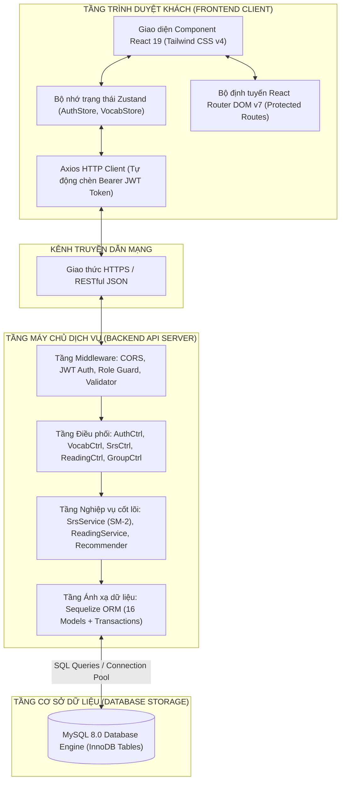

---

### 2.5.2. Danh mục các điểm cuối RESTful API chính của hệ thống

##### Bảng 2.6: Bảng danh mục các điểm cuối RESTful API chính của hệ thống

| Nhóm chức năng | Phương thức HTTP | Điểm cuối URI (Endpoint) | Quyền hạn yêu cầu | Mô tả chức năng |
| :--- | :---: | :--- | :---: | :--- |
| **Xác thực** | `POST` | `/api/auth/register` | Public | Đăng ký tài khoản người dùng mới |
| | `POST` | `/api/auth/login` | Public | Đăng nhập hệ thống, trả về Token JWT |
| | `GET` | `/api/auth/me` | Bearer Token | Lấy thông tin cá nhân của phiên hiện tại |
| **Placement Test**| `GET` | `/api/assessments/placement-test` | Bearer Token | Lấy 30 câu hỏi kiểm tra năng lực đầu vào |
| | `POST` | `/api/assessments/submit` | Bearer Token | Nộp bài kiểm tra đầu vào và nhận xếp hạng |
| **Chủ đề & Từ vựng**| `GET` | `/api/topics` | Bearer Token | Lấy danh sách các chủ đề từ vựng |
| | `GET` | `/api/topics/:id/vocabularies` | Bearer Token | Lấy danh sách từ vựng thuộc về một chủ đề |
| | `GET` | `/api/vocabularies/:id` | Bearer Token | Lấy chi tiết từ vựng kèm câu ví dụ |
| **Ôn tập SM-2** | `GET` | `/api/srs/due` | Bearer Token | Lấy danh sách các từ vựng đến hạn ôn tập hôm nay |
| | `GET` | `/api/srs/learning` | Bearer Token | Lấy danh sách từ đang học để ôn tập chủ động |
| | `POST` | `/api/srs/review` | Bearer Token | Gửi đánh giá nhớ (q: 0-5), cập nhật SM-2 |
| | `GET` | `/api/srs/stats` | Bearer Token | Lấy thống kê số từ thuộc, tỷ lệ nhớ chính xác |
| **Bài đọc hiểu** | `GET` | `/api/readings` | Bearer Token | Lấy danh sách các bài đọc chuyên ngành |
| | `GET` | `/api/readings/:id` | Bearer Token | Lấy chi tiết bài đọc song ngữ và các câu hỏi |
| | `POST` | `/api/readings/:id/submit` | Bearer Token | Nộp bài trắc nghiệm đọc hiểu, nhận điểm số |
| | `GET` | `/api/readings/recommended`| Bearer Token | Lấy danh sách các bài đọc gợi ý thích ứng |
| **Nhóm học tập** | `POST` | `/api/groups` | Bearer Token | Tạo nhóm học tập mới và nhận mã mời |
| | `POST` | `/api/groups/join` | Bearer Token | Tham gia nhóm thông qua mã mời (Invite Code) |
| | `GET` | `/api/groups/:id/members` | Group Member | Xem danh sách các thành viên trong nhóm |
| | `POST` | `/api/groups/:id/vocab-sets`| Group Owner | Tạo bộ từ vựng chuyên đề cho nhóm |
| | `DELETE`| `/api/groups/:id` | Group Owner | Xóa nhóm học tập (chỉ dành cho chủ nhóm) |
| **Quản trị CMS** | `GET` | `/api/admin/users` | Admin Role | Danh sách và tìm kiếm người dùng hệ thống |
| | `PUT` | `/api/admin/users/:id/status`| Admin Role | Khóa hoặc kích hoạt lại tài khoản người dùng |
| | `POST` | `/api/admin/vocabularies` | Admin Role | Thêm mới từ vựng vào hệ thống từ điển |

---

## 2.6. TỔNG KẾT CHƯƠNG 2

Chương 2 đã hoàn thành toàn bộ công tác phân tích yêu cầu nghiệp vụ và thiết kế kiến trúc hệ thống **EngLearn** một cách bài bản, chuẩn hóa theo phương pháp luận Công nghệ phần mềm:
1. Xác lập đầy đủ các yêu cầu chức năng (5 phân hệ) và phi chức năng, xây dựng **Ma trận phân quyền (Actor Matrix)** minh bạch giữa 4 vai trò tác nhân.
2. Mô hình hóa thành công hệ thống trên công cụ **Visual Paradigm** thông qua các biểu đồ: Use Case tổng quát, Use Case phân rã, Sequence Diagrams cho các luồng nghiệp vụ nhạy cảm (JWT, SM-2 Transaction, Đọc hiểu) và Activity Diagrams.
3. Thiết kế hoàn chỉnh mô hình dữ liệu quan hệ **ERD gồm 16 bảng dữ liệu** ở dạng chuẩn 3NF, bảo đảm tính toàn vẹn và tối ưu hóa truy vấn.
4. Xây dựng sơ đồ kiến trúc phân tầng hệ thống Client - Server và thiết kế chuẩn hóa danh mục các điểm cuối **RESTful API**.

Toàn bộ các bản thiết kế kiến trúc và mô hình dữ liệu này tạo tiền đề vững chắc để triển khai sang **Chương 3: Cài đặt thực nghiệm và Kiểm thử hệ thống**.
